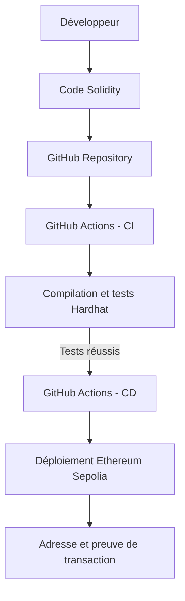

# Architecture et relation entre les technologies

## Relation avec les autres thèmes du cours

- Les **Transformers**, les **encodeurs**, les **décodeurs** et **I-JEPA** appartiennent
  au volet intelligence artificielle et apprentissage de représentations.
- Le smart contract appartient au volet **Blockchain**.
- GitHub Actions automatise l'intégration et le déploiement continus (**CI/CD**).
- Docker et Kubernetes relèvent de l'infrastructure de déploiement.
- Kubeflow applique des principes similaires aux pipelines de Machine Learning (**MLOps**).

Dans ce projet pratique, le pipeline exécuté concerne directement Solidity, Hardhat,
GitHub Actions et Sepolia. Les concepts IA, infrastructure et MLOps seront expliqués
dans le rapport afin de montrer leur place dans une architecture technologique moderne.
